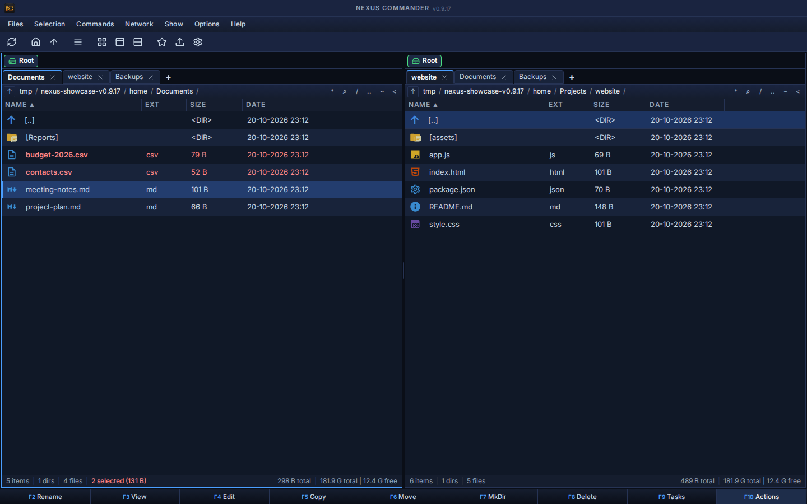
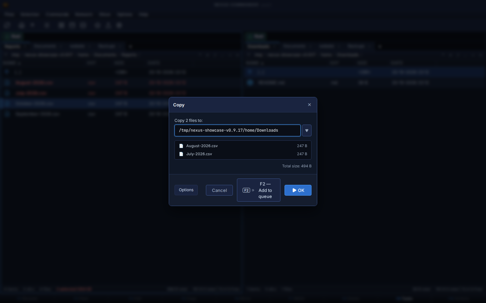
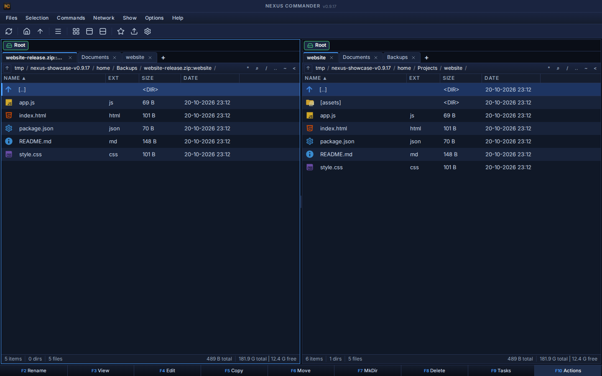
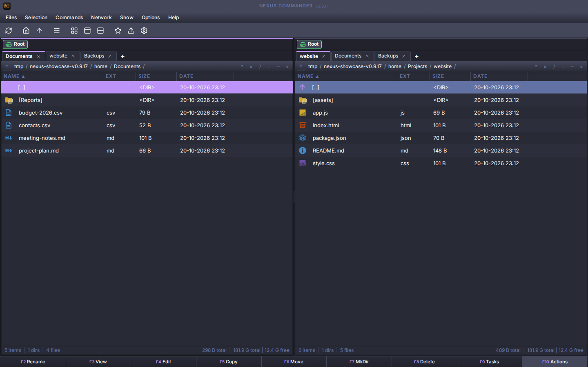

# NexusCommander (monorepo)

Eén repo met een **gedeelde Svelte-frontend** die twee shells voedt.

[](apps/web/docs/media/screenshots/dual-pane-browsing.png)

Actuele screenshots van de webversie **0.9.17**, met demonstratiebestanden. Klik op een afbeelding voor het volledige formaat.

| Bestandsbeheer | Thema's |
| --- | --- |
| [](apps/web/docs/media/screenshots/copy-with-f5.png)<br>Kopiëren met F5 | [](apps/web/docs/media/screenshots/light-themes.png)<br>GitHub Light |
| [](apps/web/docs/media/screenshots/archives-as-folders.png)<br>Archieven als mappen | [](apps/web/docs/media/screenshots/dark-themes.png)<br>Dracula |

[Alle screenshots en thema's →](apps/web/README.md#see-it-in-action)

## Monorepo

```
NexusCommander/
├── packages/
│   └── ui/            @nexus/ui — gedeelde frontend (transport-agnostisch)
│       └── src/lib/   ipc-contract.ts (NexusIpc) · ipc-registry.ts (getIpc/setIpc)
│                      ipc.ts (shim) · types.ts · stores.ts · i18n.ts · theme.ts
│                      utils.ts · iconMap.ts · plugin-api.ts · playerStore.ts · locales/
├── apps/
│   ├── desktop/       Tauri-shell (Rust-backend) — Linux/macOS/Windows
│   │   ├── src/lib/ipc.ts      invoke()-adapter (implements NexusIpc)
│   │   └── src-tauri/          Rust-backend
│   └── web/           SvelteKit + Express-shell (PWA)
│       ├── src/lib/ipc.ts      fetch()-adapter (implements NexusIpc)
│       └── server/             Express-backend
└── docs/
```

## Architectuur in één alinea

De gedeelde UI kent alleen het **`NexusIpc`-contract** ([packages/ui/src/lib/ipc-contract.ts](packages/ui/src/lib/ipc-contract.ts)). Elke app levert bij opstart zijn adapter via `setIpc(...)`; gedeelde componenten roepen `getIpc()` aan. Zo draait dezelfde componentboom op Tauri (`invoke`) én web (`fetch`). Platformverschillen zitten achter capability-detectie (`getIpc().setFileProperties?.(…)`), niet verspreid door de UI. **Backends worden nooit gedeeld** — zie [docs/archive/BACKENDS_EN_SECURITY.md](docs/archive/BACKENDS_EN_SECURITY.md).

## Commando's (npm workspaces)

```bash
npm install                 # installeert alle workspaces (packages/ui gesymlinkt)

npm run dev:desktop         # tauri dev
npm run dev:web             # vite dev + express (concurrently)

npm run build               # bouwt beide apps
npm run build:desktop       # alleen desktop-frontend (vite)
npm run build:windows       # Windows-setup (.exe, NSIS)
npm run build:web           # alleen web
npm run tauri -- build      # Tauri-bundle (Linux/macOS/Windows)

npm run check               # svelte-check beide apps
```

Rust-backend checken: `cd apps/desktop/src-tauri && cargo check`.

Voor een installeerbare Windows-versie: zie
[apps/desktop/docs/WINDOWS_INSTALL.md](apps/desktop/docs/WINDOWS_INSTALL.md).

## Status

**Deze repo is het implementatiedoel.** De losse desktop-repo
(`_Apps/NexusCommander`) is bevroren — zie [docs/REPO_STATUS.md](docs/REPO_STATUS.md).

Fases 0–8 van de migratie zijn afgerond: 24 gedeelde `.svelte`-componenten, de
gedeelde niet-visuele logica (ipc-contract/shim, types, stores, i18n-loader, utils,
theme, iconMap, plugin-api, playerStore) staat in `@nexus/ui`, de locales zijn
geünificeerd en CI bouwt op Linux, macOS en Windows.

Nog open in Fase 9: de Svelte-reconciliatie van desktop-release v0.8.34, de
handmatige visuele regressietest, en het archiveren van de oude repo. Alle details
en de per-bestand-inventaris staan in [docs/REPO_STATUS.md](docs/REPO_STATUS.md).

Kwaliteit en veiligheid: [docs/COMPREHENSIVE_QUALITY_SAFETY_UPGRADE_PLAN_2026-07-28.md](docs/COMPREHENSIVE_QUALITY_SAFETY_UPGRADE_PLAN_2026-07-28.md)
is de huidige baseline. Behandel releases tot en met Fase 2 daarvan als preview.
