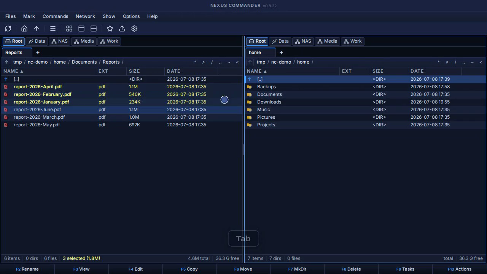
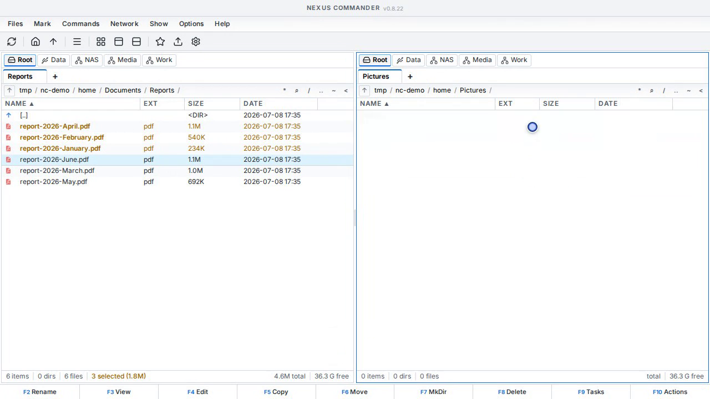
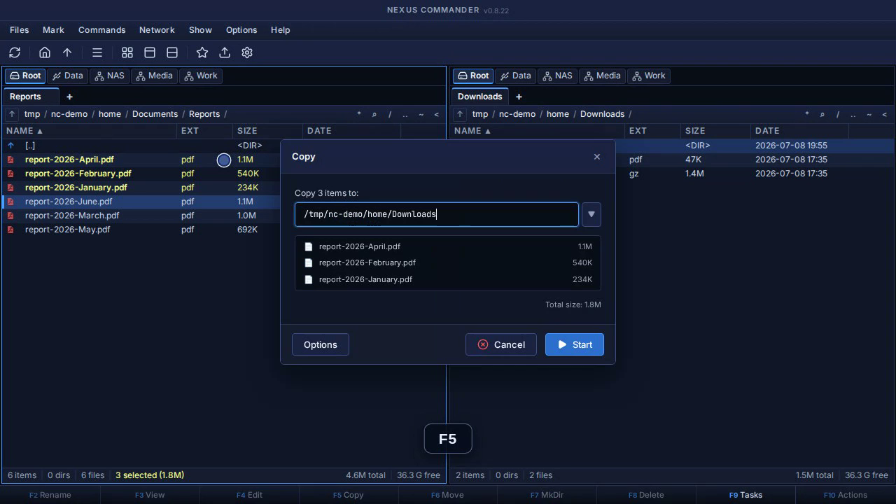
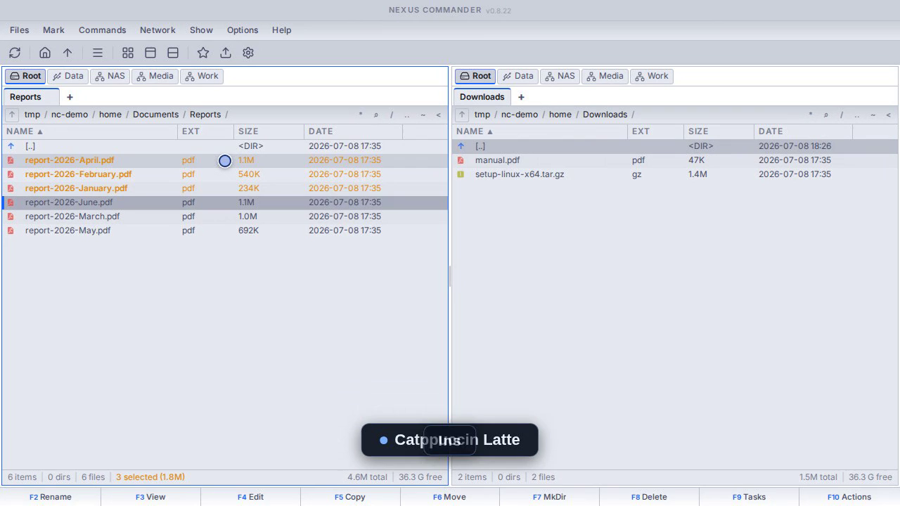
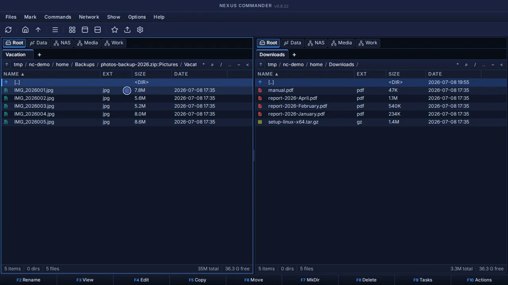
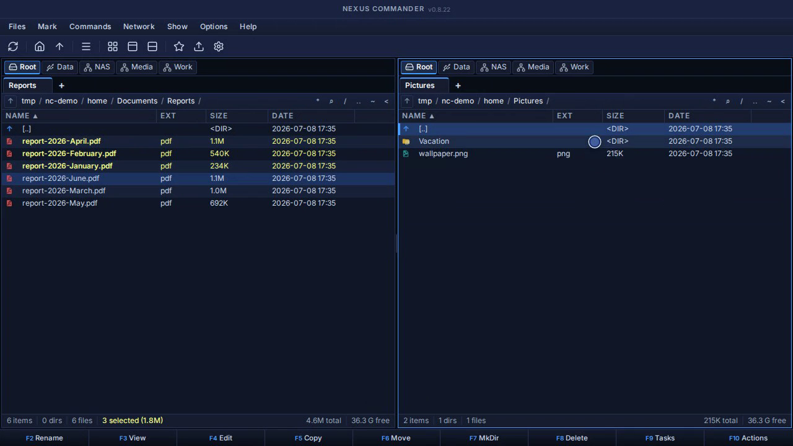

# NexusCommander

A web-native, dual-pane (orthodox) file manager. SvelteKit frontend, Express backend, installable as a PWA — no Electron.

[](docs/media/demo-videos/01-dual-pane-browsing.mp4)

## The Origin Story

I have a confession: I am completely addicted to the orthodox, twin-panel file management workflow. If you are reading this, you probably are too.

My computing habits were forged by absolute legends. I have massive respect and admiration for the titans of this space: Norton Commander, Total Commander, Double Commander, and Gnome Commander. They are brilliant pieces of software that have saved developers and power users millions of clicks over the decades.

But as much as I loved them, I always found myself wanting just a little bit more. Sometimes it was a UI that felt a bit dated, sometimes it was friction in cross-platform behavior, or simply the desire for a more modern aesthetic. Mostly, I wanted to see if I could build a file manager that combined the speed and directness of traditional desktop tools with the fluid UI capabilities of modern web frameworks, without dragging in the weight of Electron.

So, I decided to build my own. Welcome to Nexus Commander.

Nexus Commander is a dual-pane file manager with a SvelteKit frontend and an Express backend that exposes the local file system to the web UI. The project is aimed at a web-native workflow: fast file navigation, classic commander-style operations, and standalone deployment without Electron.

## Features

- **Twin panels**: classic dual-pane layout with vertical/horizontal split, folder tabs, tree view and breadcrumb navigation
- **Commander-style operations**: F3 view, F4 edit, F5 copy, F6 move/rename, F7 mkdir, F8 delete — with SSE-driven background task progress and conflict handling. The **Selection Style** setting controls the working style: Norton Commander mode uses right-click to select, while Windows mode uses right-click for the context menu.
- **Archives as virtual folders**: browse ZIP/TAR(.GZ/.BZ2/.XZ)/7Z/RAR like directories; pack, unpack, test, and copy entries straight to the opposite panel
- **Built-in viewers**: CodeMirror-based editor with syntax highlighting, image viewer with zoom, PDF preview, audio/video player (with ffmpeg remux for mkv/avi), and Office document previews via LibreOffice — designed to work on headless servers where no desktop apps exist
- **Power tools**: multi-rename with patterns, advanced search (regex + content, "feed to listbox"), file split & combine, directory comparison, recursive size calculation
- **File properties**: tabbed dialog with metadata, chmod (incl. SUID/SGID/sticky) and chown editing, plus a sudo-backed elevation flow for permission-denied operations
- **Personalization**: hotlist/bookmarks, multiple themes (dark/light/cyberpunk and more), icon theme mapping (Material, Papirus, Lucide), fully localized UI (English, Dutch, German, French, Spanish, Portuguese)
- **PWA**: installable as a standalone app window (ChromeOS, Linux, desktop Chrome, Android), Window Controls Overlay support, offline-capable UI shell
- **Mobile & touch**: responsive layout with touch-optimized interactions (tap to open, touch multi-select, safe-area support) — manage your server's files from a phone or tablet browser, or install it to your home screen (tested on Android; iOS not yet tested)

## See It in Action

Click a preview to watch the short demo.

| Core workflow | Themes |
| --- | --- |
| [](docs/media/demo-videos/01-dual-pane-browsing.mp4)<br>**Dual-pane browsing** | [](docs/media/demo-videos/04-light-themes.mp4)<br>**Light theme gallery** |
| [](docs/media/demo-videos/02-copy-with-f5.mp4)<br>**Copy files with F5** | [](docs/media/demo-videos/05-light-mode-in-use.mp4)<br>**Light mode in use** |
| [](docs/media/demo-videos/03-archives-as-folders.mp4)<br>**Browse archives as folders** | [](docs/media/demo-videos/06-dark-themes.mp4)<br>**Dark theme gallery** |

## Stack

- frontend: Svelte 5 (Runes), SvelteKit, Vite, Tailwind CSS v4
- backend: Express on Node.js 22+
- deployment target: any Linux machine — from your local workstation to a small headless server or container

## Requirements

- **Node.js 22+**
- Optional CLI tools that unlock extra features (everything else keeps working without them):
  - `tar` — .tar/.tar.gz/.tar.bz2/.tar.xz support (present on virtually all Linux systems)
  - `7zip` (≥ ~21.x, e.g. `apt install 7zip`) — .7z and .rar/.rar5 support; avoid the older `p7zip` fork
  - `ffmpeg` — on-the-fly remux so mkv/avi play in the built-in media player
  - `libreoffice` — converted previews for docx/xlsx/pptx/odt/ods/odp

## Quick Start

Install dependencies:

```bash
npm install
```

Run the development setup:

```bash
npm start
```

This starts:

- Vite dev server on `5173`
- Express backend on `3721`

The backend accepts only trusted browser origins, so the app can still be used from another device on the LAN without opening the API to arbitrary websites.

## Standalone Mode

Build and run the standalone app, where the Express server hosts both the API and the built frontend on one origin:

```bash
npm run build
cp .env.example .env
npm run serve
```

Or use the convenience command:

```bash
npm run prod
```

Default standalone endpoints:

- app: `http://127.0.0.1:3721/`
- health: `http://127.0.0.1:3721/api/health`

## Configuration

Configuration happens through environment variables (or an `.env` file, see [.env.example](.env.example)):

| Variable | Default | Purpose |
| --- | --- | --- |
| `NC_HOST` | all interfaces (dev) / `127.0.0.1` (example env) | address the backend binds to |
| `NC_PORT` | `3721` | backend port |
| `NC_ALLOWED_ORIGINS` | dev origins | comma-separated browser origins allowed to call the API |
| `NC_ALLOWED_ORIGIN_PORTS` | `3721,4173,5173` | shortcut to allow any host on these ports |
| `NC_FORCE_HEADLESS` | unset | force headless behavior (no host app launching) even when a desktop session exists |

User settings (themes, layout, bookmarks) are stored in `~/.config/nexuscommander/config.json`.

## Security Model — Read This Before Deploying

NexusCommander's backend is a bridge to the file system of the account it runs as. Anyone who can reach the API can read, modify and delete those files. Design assumptions:

- It is built for **personal use on trusted networks**: localhost, your LAN, or a private VPN/tailnet.
- There is **no built-in user authentication**. The origin allowlist protects against random websites scripting the API through your browser, but not against direct network access.
- **Never expose the port directly to the public internet.** If you want remote access, put it behind a VPN (Tailscale/WireGuard) or an authenticating reverse proxy, and use HTTPS.
- The optional privilege-elevation feature forwards a sudo password to the backend for a whitelisted set of operations — only use it over HTTPS or localhost.

## Deployment

For running NexusCommander as a service on a Linux (optionally headless) machine, the repo ships example configs:

- [deploy/nexuscommander.service](deploy/nexuscommander.service) — systemd unit (adjust user and path)
- [deploy/nexuscommander.Caddyfile](deploy/nexuscommander.Caddyfile) — minimal Caddy reverse proxy

On a headless server there is no desktop session to hand files off to — that's what the built-in viewer/editor/player stack is for. See the [installation guide](docs/installer_guide.md) for the full walkthrough, including PWA installation on ChromeOS/Linux.

## Documentation

- [docs/installer_guide.md](docs/installer_guide.md) — installation, standalone production and service deployment
- [docs/TECH_STACK.MD](docs/TECH_STACK.MD) — technologies and libraries used
- [docs/CODING_STANDARDS.md](docs/CODING_STANDARDS.md) — architectural patterns and contribution standards

## Versioning

The repo includes a version bump helper:

```bash
./scripts/bump-version.sh 0.8.3
```

That updates the npm version plus app-facing version strings used by the standalone build.

## Contributing

Issues and pull requests are welcome. Before submitting a PR, please run:

```bash
npm run check
npm run build
```

All user-visible strings must go through the i18n system (`$_()` with keys in `server/langs/{en,nl,de,fr,es,pt}.json`) — see [docs/CODING_STANDARDS.md](docs/CODING_STANDARDS.md).

## License

[MIT](LICENSE)
