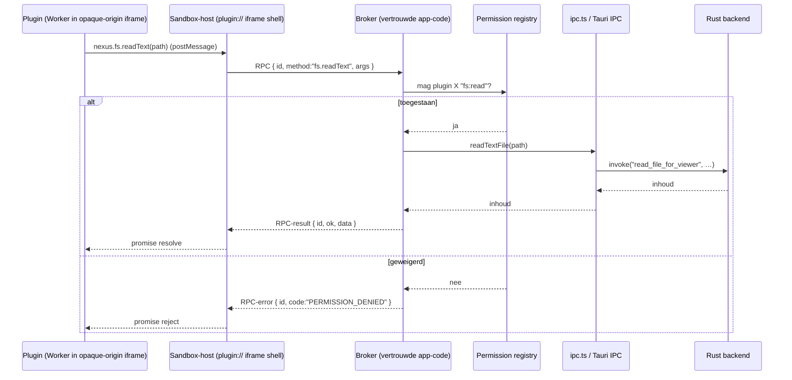

# NexusCommander — Plan: Extensie-/pluginsysteem

> Status: **ontwerp / voorstel** · Datum: 2026-07-22 · App-versie op moment van schrijven: v0.8.31
> Auteur: djawiz (opgesteld met Claude Code)
> Doel: NexusCommander uitbreidbaar maken via extensies, met een veilig, gefaseerd en realistisch pad van MVP naar volwaardig ecosysteem.

---

## 0. Samenvatting (TL;DR)

NexusCommander heeft al een **ontwerp-stub** voor plugins in [src/lib/plugin-api.ts](../src/lib/plugin-api.ts): een complete TypeScript API-definitie (`NexusAPI`, `PluginManifest`, `NexusPlugin`, permissies, events), maar **zonder enige runtime-implementatie** — het bestand wordt nergens geïmporteerd. Dit plan bouwt dáárop voort en maakt er een werkend systeem van.

De kern van dit plan is een **gelaagd model** dat waarde vroeg oplevert en risico laat opschaalt:

| Tier | Wat | Sandbox nodig? | Fase |
| --- | --- | --- | --- |
| **Tier 0 — Declaratief** | Thema's, keybindings, menu-/toolbaritems, bestandsassociaties, externe-tool-commando's (à la Total Commander button bar) | Nee | Fase 1 |
| **Tier 1 — Logica-plugins** | Custom commando's, hernoemers, custom kolommen, event-hooks — JS in een sandbox met de gebrokerde `nexus`-API | Ja (iframe + Web Worker) | Fase 2–3 |
| **Tier 2 — UI-plugins** | Eigen panelen, custom viewers, statusbar-items | Ja (iframe-webview) | Fase 4 |

De **belangrijkste technische horde** is de strikte Content-Security-Policy (`script-src 'self'`). Het antwoord daarop is: plugins draaien **nooit** in de hoofd-webview en raken **nooit** rechtstreeks Tauri-IPC aan. Ze draaien in een **opaque-origin sandbox-iframe** (geladen via een eigen `plugin://`-URI-scheme met eigen CSP) en praten uitsluitend via `postMessage` met een **broker** in de vertrouwde app-code. Die broker dwingt het permissiemodel af en roept pas dán de bestaande [ipc.ts](../src/lib/ipc.ts)-functies aan. Zo blijft het Tauri-ACL simpel en houdt de app volledige controle.

---

## 1. Context: huidige architectuur (geverifieerd)

Kort overzicht van wat er nú is, want het extensiesysteem moet hierop aansluiten.

### Backend (Rust / Tauri v2)
- Modulaire opzet: `vfs`, `archive`, `task_queue`, `viewer`, `bookmarks`, `search`, `terminal`, `settings`, `network`, `help`, `open_with` — zie [src-tauri/src/lib.rs](../src-tauri/src/lib.rs).
- Commando's geregistreerd via één `invoke_handler(generate_handler![...])` in [lib.rs:323](../src-tauri/src/lib.rs#L323).
- Config-opslag via Tauri `app_config_dir()` — zie [settings.rs:94](../src-tauri/src/settings.rs#L94) (`get_config_path`). Op Linux is dit `~/.config/com.nexus.nextgen.commander/` (identifier uit [tauri.conf.json](../src-tauri/tauri.conf.json)).
- Tauri-ACL minimaal: alleen `core:default` + `opener:default` in [capabilities/default.json](../src-tauri/capabilities/default.json). Er is bewust géén `shell`- of ruime `fs`-capability.

### Frontend (Svelte 5 / SvelteKit static)
- IPC-wrapperlaag: [src/lib/ipc.ts](../src/lib/ipc.ts) (441 regels) — elke backend-call heeft hier een getypte wrapper.
- State via stores: [src/lib/stores.ts](../src/lib/stores.ts) — o.a. `activePanel`, `leftPanelPath`/`rightPanelPath`, `clipboardStore`, `globalContextMenuStore`, `appConfigStore`.
- **Centrale command-bus:** custom DOM-events. Menu's en de command palette dispatchen `window.dispatchEvent(new CustomEvent("nc:menu-action", { detail: action }))`; de centrale afhandelaar is `handleMenuAction` in [+page.svelte:175](../src/routes/+page.svelte#L175).
- Command palette: [ActionPalette.svelte](../src/lib/components/ActionPalette.svelte) met een `ActionItem[]`-lijst en `trigger`-strings.
- Menu: [MenuBar.svelte](../src/lib/components/MenuBar.svelte) (dispatcht `nc:menu-action`).
- Keybindings: hardcoded in `handleKeydown` in [+page.svelte](../src/routes/+page.svelte) (Ctrl+P, F12, F10, Ctrl+R). Er is nog **geen** keybinding-registry.
- Thema-engine: CSS-variabelen via [src/lib/theme.ts](../src/lib/theme.ts).
- i18n: JSON-locales in [src/lib/locales/](../src/lib/locales/) + `check-locales.js`.

### Kritieke constraint: CSP
In [tauri.conf.json](../src-tauri/tauri.conf.json):
```
default-src 'self'; script-src 'self'; ... object-src 'none'; base-uri 'self'; frame-ancestors 'none'
```
`script-src 'self'` betekent: de hoofd-webview weigert elk script dat niet van de app-origin komt. Een plugin uit `~/.config/.../plugins/foo/main.js` kun je dus **niet** zomaar `import()`-en of injecteren. Dit stuurt de hele architectuur (zie §3).

### Wat er al ligt en waarop we voortbouwen
[src/lib/plugin-api.ts](../src/lib/plugin-api.ts) definieert al:
- `PluginManifest` (id, name, version, minAppVersion, main, permissions, menuItems, keybindings, fileAssociations).
- `PluginPermission` (`fs:read`, `fs:write`, `fs:execute`, `net:http`, `ui:panel`, `ui:dialog`, `ui:statusbar`, `system:env`, `system:shell`).
- `NexusAPI` (`plugin`, `fs`, `ui`, `panel`, `events`, `commands`, `shell`) + supporting types.
- `NexusEvent` (panel/file/viewer/app-hooks, incl. cancelbare `before*`-events).
- `NexusPlugin` lifecycle (`activate`/`deactivate`).

Dit plan behandelt die stub als **contract v1** en beschrijft de implementatie eromheen.

---

## 2. Doelen, niet-doelen en principes

### Doelen
1. Third parties (en jij zelf) kunnen NexusCommander uitbreiden zonder de core te forken.
2. Veiligheid-eerst: extensies zijn standaard beperkt en expliciet toestemming vragen (least privilege).
3. Gefaseerd: eerste bruikbare extensies zonder dat de zware sandbox af is.
4. Aantrekkelijk voor de OFM-/Svelte-community (README nodigt hier expliciet toe uit).
5. Cross-platform-veilig ontwerp (Linux nu, Windows/macOS op de roadmap).

### Niet-doelen (afbakening v1)
- **Geen** native/binaire plugins die in het app-proces geladen worden (te riskant, cross-platform-hel). Native uitbreiding kan later via het **externe-proces**-model (§3, optie C).
- **Geen** automatische updates van plugins uit willekeurige URL's in v1 (supply-chain-risico).
- **Geen** volwaardige online marketplace in de eerste fasen; wel voorbereiden.
- **Geen** herschrijving van de hele UI naar "alles is een plugin". De core blijft de core.

### Ontwerpprincipes
- **Broker-model:** plugins raken nooit `invoke`/Tauri-IPC of de app-DOM rechtstreeks aan. Alles loopt via een vertrouwde broker die permissies afdwingt.
- **Declaratief waar het kan, code waar het moet.** Veel OFM-uitbreidingen (tools, packers, viewers, thema's) zijn puur declaratief → grote waarde, nul code-uitvoering.
- **Contributiepunten, geen monkey-patching.** Plugins registreren bijdragen via een registry; ze mogen de app-internals niet muteren.
- **Stabiel contract, versiebeheer.** `apiVersion`/`minAppVersion` bewaken compatibiliteit.

---

## 3. Architectuurkeuze: hoe voeren we plugincode uit?

Dit is dé beslissing. Vier opties, afgewogen tegen onze CSP-constraint en het security-eerst-principe.

### Optie A — Sandbox-iframe + Web Worker + `postMessage`-broker ✅ **aanbevolen**
- Plugin-JS draait in een `<iframe sandbox="allow-scripts">` (dus **opaque origin**, géén `allow-same-origin`). De iframe-inhoud wordt geserveerd via een **eigen Tauri URI-scheme** (`register_uri_scheme_protocol`, bv. `plugin://`) met een **eigen, plugin-vriendelijke CSP**. De hoofd-CSP krijgt alleen `frame-src plugin:` erbij.
- Voor **logica-plugins** (Tier 1) draait de plugincode binnen die iframe in een **Web Worker** → helemaal geen DOM.
- Communicatie uitsluitend via `postMessage`. De **broker** (vertrouwde app-code) mapt elke API-call op een vereiste permissie, checkt de door de gebruiker verleende set, en roept dan pas [ipc.ts](../src/lib/ipc.ts) aan.
- ✅ Voordelen: CSP-conform, sterke isolatie (opaque origin kan geen Tauri-IPC bereiken), plugins in JS/TS (past bij de community), één bridge voor Tier 1 én Tier 2.
- ⚠️ Nadelen: postMessage-serialisatie-overhead; async-only API; iframe-lifecycle-beheer.

### Optie B — QuickJS/WASM-engine (bv. `rquickjs` in Rust)
- Plugin-JS draait in een ingebedde JS-engine, zonder DOM, met host-functies gemapt op de Rust-modules. Permissies afgedwongen in Rust.
- ✅ Sterkste isolatie voor pure-logica-plugins; geen CSP-issue.
- ⚠️ Geen DOM/UI (UI wordt puur declaratief); extra zware dependency; twee runtimes onderhouden. Overweeg dit later als hardening voor "trusted compute"-plugins.

### Optie C — Externe-proces-plugins (stdio / JSON-RPC, à la LSP)
- Plugin = los uitvoerbaar bestand/script dat via stdio JSON-RPC praat. OS-procesgrens = maximale isolatie; taalonafhankelijk.
- ✅ Ideaal voor zware tools (indexers, custom VFS/mounts, packers).
- ⚠️ Meer overhead, lastiger UI-integratie, vereist `system:shell`-achtige rechten. Reserveren voor "power tools" later.

### Optie D — Puur declaratief (geen code)
- Alleen manifests: thema's, keybindings, menu-items, bestandsassociaties, externe-tool-commando's met placeholders (`%P` pad, `%N` naam, `%S` selectie).
- ✅ Vrijwel nul aanvalsoppervlak, snel te bouwen, dekt een verrassend groot deel van echte OFM-uitbreidingen.
- ⚠️ Niet krachtig genoeg voor alles.

### Besluit: **gelaagd = A bovenop D**
- **Tier 0 = Optie D** (Fase 1): direct waarde, geen sandbox.
- **Tier 1 & 2 = Optie A** (Fase 2+): de `nexus`-API uit [plugin-api.ts](../src/lib/plugin-api.ts), gebrokerd.
- **Optie B/C** blijven op de plank als latere hardening/uitbreiding, expliciet buiten v1-scope.

### Datastroom (Tier 1/2, aanbevolen model)



De plugin ziet alleen de `nexus`-API; de broker is de enige die `invoke` mag aanroepen.

---

## 4. Componenten die we moeten bouwen

### 4.1 Plugin-opslag & -ontdekking
- Locatie: `~/.config/com.nexus.nextgen.commander/plugins/<plugin-id>/` (afgeleid van `app_config_dir()`, consistent met [settings.rs](../src-tauri/src/settings.rs)).
  > Let op: de comment in [plugin-api.ts](../src/lib/plugin-api.ts) noemt `~/.config/nexuscommander/plugins/`. Uitlijnen op de echte identifier-map of expliciet een symlink/alias documenteren.
- Elke plugin: map met `manifest.json` + code + assets + optioneel `icon`, `README`, `LICENSE`.
- Nieuwe Rust-module `plugins.rs`: `list_plugins`, `read_plugin_manifest`, `install_plugin` (uit `.ncplugin`-zip of map), `uninstall_plugin`, `read_plugin_file` (gescoped, alleen binnen de plugin-map). Registreren in [lib.rs](../src-tauri/src/lib.rs) `invoke_handler`.
- Per-plugin datamap voor plugin-state: `.../plugins/<id>/.data/` → exposed als `nexus.plugin.dataDir`.

### 4.2 Manifest v1 (uitbreiding van de bestaande stub)
Behoud de velden uit [plugin-api.ts](../src/lib/plugin-api.ts) en voeg toe:
```jsonc
{
  "id": "com.example.hello",
  "name": "Hello Plugin",
  "version": "1.0.0",
  "apiVersion": "1",              // NIEUW: pin op plugin-API-contract
  "minAppVersion": "0.9.0",
  "author": "…",
  "description": "…",
  "tier": "logic",               // NIEUW: "declarative" | "logic" | "ui"
  "main": "main.js",             // alleen voor logic/ui
  "permissions": ["fs:read", "ui:dialog"],
  "contributes": {               // NIEUW: declaratieve bijdragen (Tier 0)
    "commands":   [{ "id": "hello.run", "title": "Say Hello", "category": "Hello" }],
    "menus":      [{ "path": "Plugins/Hello/Say Hello", "command": "hello.run", "icon": "👋" }],
    "keybindings":[{ "keys": "Ctrl+Shift+H", "command": "hello.run", "when": "always" }],
    "fileAssociations": [{ "extensions": ["hello"], "viewer": "hello.viewer" }],
    "externalTools":[{ "id":"hello.grep", "title":"Grep here", "exec":"grep", "args":["-r","%S","%P"] }],
    "themes":     [{ "id":"hello-dark", "label":"Hello Dark", "path":"themes/dark.json" }],
    "columns":    [{ "id":"hello.rating", "title":"Rating", "provider":"hello.ratingProvider" }]
  },
  "configuration": {             // NIEUW: door gebruiker instelbare plugin-settings
    "hello.greeting": { "type":"string", "default":"Hi", "description":"Groet" }
  }
}
```
- JSON-Schema voor het manifest committen (validatie + editor-autocomplete).
- Semver-checks op `apiVersion` en `minAppVersion` bij laden.

### 4.3 Contributie-registry (frontend)
Nieuw: `src/lib/plugins/registry.ts` — een centrale, reactieve registry (Svelte store) met:
- `commands: Map<id, {title, category, handler|pluginId}>`
- `menus`, `keybindings`, `statusBarItems`, `panels`, `viewers`, `columns`, `themes`.
- API voor de app: `getPluginCommands()`, `getPluginMenus()`, enz.
Bestaande UI wordt **data-gedreven** gevoed uit deze registry:
- [ActionPalette.svelte](../src/lib/components/ActionPalette.svelte): huidige statische `actions`-lijst mergen met `registry.commands`.
- [MenuBar.svelte](../src/lib/components/MenuBar.svelte): een top-level **"Plugins"**-menu opbouwen uit `registry.menus`.
- Keybindings: nieuwe `keybindingRegistry` + refactor van de hardcoded `handleKeydown` in [+page.svelte](../src/routes/+page.svelte) naar een centrale, registry-gedreven dispatcher (voorwaarde voor plugin-keybindings én netjes voor de core zelf).
- Context menu: bijdragen via [globalContextMenuStore](../src/lib/stores.ts).

### 4.4 De broker + sandbox-host (Tier 1/2)
- `src/lib/plugins/host/` — de `plugin://`-shell-HTML + bootstrap die de plugin in een Worker laadt en de `nexus`-proxy injecteert (elke methode = `postMessage`-RPC met correlation-id → Promise).
- `src/lib/plugins/broker.ts` — vertrouwde kant: ontvangt RPC's, valideert tegen `permissionRegistry`, roept [ipc.ts](../src/lib/ipc.ts) aan, stuurt resultaat terug. Bevat de **volledige mapping** van `NexusAPI`-methoden → ipc-functies → vereiste permissie.
- Rust: `register_uri_scheme_protocol("plugin", …)` in [lib.rs](../src-tauri/src/lib.rs) die de shell + pluginbestanden serveert met eigen CSP; hoofd-CSP uitbreiden met `frame-src plugin:` (en `worker-src` waar nodig).

### 4.5 Event-/hook-systeem
- Nieuw intern `eventBus` (typed) dat de `NexusEvent`-set uit [plugin-api.ts](../src/lib/plugin-api.ts) dekt.
- **Notificatie-events** (`panel:navigate`, `*:after*`, `viewer:open`, `app:ready`) eerst: op bestaande plekken emitten (bv. bij paneelnavigatie, na copy/move/delete in [+page.svelte](../src/routes/+page.svelte)).
- **Cancelbare `before*`-events** later (Fase 3): vereist dat de betrokken operatie-aanroepplekken `await`-en op een plugin-veto. Dit is echt werk en raakt de call-sites van copy/move/delete/rename — apart faseren.

### 4.6 Permissiemodel & consent
- `permissionRegistry`: per plugin de door de gebruiker **verleende** permissies (opgeslagen in settings, niet in het manifest — het manifest *vraagt*, de gebruiker *verleent*).
- **Consent-UI** bij installeren/eerste activatie: toon gevraagde permissies met risico-labels. "Gevaarlijke" permissies (`fs:write`, `fs:execute`, `net:http`, `system:shell`, `system:env`) krijgen extra nadruk en aparte bevestiging.
- Runtime-enforcement in de broker; bij ontbrekend recht → `PERMISSION_DENIED` (geen stille fallback).
- `system:shell` vereist een échte Tauri-capability (bv. `tauri-plugin-shell` met **gescoopte** ACL). Dit is de hoogste risicoklasse → achteraan in de roadmap, achter een expliciete "sta uitvoeren van commando's toe"-toggle, met scope-restricties.

### 4.7 Plugin Manager-UI
Nieuwe dialog (in de stijl van [OptionsDialog.svelte](../src/lib/components/OptionsDialog.svelte)):
- Lijst van geïnstalleerde plugins: naam, versie, status (aan/uit), tier, permissies.
- Acties: inschakelen/uitschakelen, permissies bekijken/intrekken, verwijderen, "map openen", plugin-instellingen (uit `configuration`).
- "Installeer plugin…" (map of `.ncplugin`-bestand kiezen via bestaande `rfd`-dialoog).
- Dev-modus: "map watchen + hot reload" en een console/logpaneel per plugin.

### 4.8 Developer SDK & DX
- Extraheer [plugin-api.ts](../src/lib/plugin-api.ts) naar een publiceerbaar `@nexuscommander/plugin-api` (types + kleine runtime-helper). Blijft in-repo als *source of truth*.
- `create-nexus-plugin`-scaffold (map met manifest + `main.ts` + build-config).
- Voorbeeldplugins in `examples/plugins/` (zie §7).
- Docs: `docs/plugins/` met "Getting started", API-referentie (gegenereerd uit de types), manifest-referentie, permissie-uitleg, security-model.

---

## 5. Contributiepunten (concreet, gekoppeld aan bestaande code)

| Contributie | Waar het inhaakt | Werk |
| --- | --- | --- |
| **Commando** | `registry.commands` → ActionPalette + `nc:menu-action`-bus | ActionPalette data-gedreven maken |
| **Menu-item** | Nieuw "Plugins"-menu in [MenuBar.svelte](../src/lib/components/MenuBar.svelte) | Menu deels data-gedreven |
| **Keybinding** | Nieuwe `keybindingRegistry` i.p.v. hardcoded `handleKeydown` | Refactor + conflictdetectie |
| **Context-menu-item** | [globalContextMenuStore](../src/lib/stores.ts) / [ContextMenu.svelte](../src/lib/components/ContextMenu.svelte) | Bijdrage-slot toevoegen |
| **Statusbar-item** | Nieuwe statusbar-contributiezone | Statusbar-slot bouwen |
| **Custom kolom** | [FileList.svelte](../src/lib/components/FileList.svelte) | Kolom-provider-API |
| **Custom viewer** | [FileViewer.svelte](../src/lib/components/FileViewer.svelte) + `fileAssociations` | Viewer-registratie + iframe-host |
| **Custom paneel** | [TwinPanels.svelte](../src/lib/components/TwinPanels.svelte) / quick view | Paneel-slot + iframe-host |
| **Thema** | CSS-variabelen via [theme.ts](../src/lib/theme.ts) | Thema uit JSON laden |
| **Externe tool** | Nieuw, via `open_with`/`terminal`-achtige exec | Placeholder-expansie (`%P/%N/%S`) |
| **Event-hook** | Nieuw `eventBus` | Emitters op call-sites |

---

## 6. Gefaseerd stappenplan

Stijl conform bestaande docs: 🔴 blokkerend/kritiek · 🟠 hoog · 🟡 midden · 🟢 laag · grootte [XS/S/M/L/XL].

### Fase 0 — Fundament & beslissingen 🔴 [M]
- [ ] Architectuurbesluit bevestigen (§3: gelaagd, Optie A+D). *(Zie "Open beslissingen", §10.)*
- [ ] `apiVersion`-contract vastleggen; [plugin-api.ts](../src/lib/plugin-api.ts) → SDK-pakket extraheren (types blijven leidend).
- [ ] Manifest v1 + JSON-Schema committen.
- [ ] Opslaglocatie + Rust-module `plugins.rs` (list/read/install/uninstall, gescoopte bestandslezing).
- [ ] Registry-skeletten (`registry.ts`, `permissionRegistry`, `eventBus`) — nog leeg, wel getypeerd.
**Resultaat:** contract + opslag staan; nog geen zichtbare features.

### Fase 1 — Declaratieve extensies (Tier 0) 🟠 [L] — *eerste bruikbare release*
- [ ] Manifest-loader + validatie + versionchecks.
- [ ] Contributie-registry vullen uit manifests.
- [ ] [ActionPalette.svelte](../src/lib/components/ActionPalette.svelte) en [MenuBar.svelte](../src/lib/components/MenuBar.svelte) data-gedreven (Plugins-menu).
- [ ] `keybindingRegistry` + refactor hardcoded keybindings.
- [ ] Thema-plugins (JSON → CSS-variabelen in [theme.ts](../src/lib/theme.ts)).
- [ ] Externe-tool-commando's met placeholder-expansie (`%P/%N/%S/%T`) + veilige exec.
- [ ] Bestandsassociaties (open-with/viewer-routing).
- [ ] **Plugin Manager-UI** (lijst, aan/uit, installeren, verwijderen).
**Resultaat:** thema's, sneltoetsen, menu-tools en associaties werken — zonder codesandbox. Grote waarde, laag risico.

### Fase 2 — Sandbox & broker (Tier 1: logica-plugins) 🟠 [XL]
- [ ] `plugin://`-URI-scheme in Rust + eigen CSP; hoofd-CSP uitbreiden (`frame-src plugin:`).
- [ ] Sandbox-host (opaque-origin iframe + Web Worker) + `nexus`-proxy.
- [ ] Broker + volledige mapping `NexusAPI` → [ipc.ts](../src/lib/ipc.ts) + vereiste-permissie-tabel.
- [ ] **Permissie-consent-UI** + `permissionRegistry`-persistentie.
- [ ] Implementeren: `nexus.plugin`, `nexus.fs`, `nexus.ui` (message/input/confirm/notification/statusbar/refresh), `nexus.panel`, `nexus.commands`.
- [ ] Notificatie-events (`panel:navigate`, `*:after*`, `viewer:open`, `app:ready`) emitten.
- [ ] Plugin-lifecycle: `activate`/`deactivate`, foutisolatie (een crashende plugin sloopt de app niet).
**Resultaat:** echte JS-plugins die commando's registreren en veilig bestands-/UI-acties doen.

### Fase 3 — Cancelbare hooks 🟡 [L]
- [ ] `before*`-events (copy/move/delete/rename) op de call-sites in [+page.svelte](../src/routes/+page.svelte) `await`-baar maken met veto.
- [ ] Timeout/failsafe: trage plugin mag een operatie niet oneindig blokkeren.
**Resultaat:** plugins kunnen operaties valideren/annuleren (bv. "bevestig verwijderen van >100 bestanden").

### Fase 4 — UI-extensies (Tier 2) 🟡 [XL]
- [ ] iframe-panelen (custom paneel-slot in [TwinPanels.svelte](../src/lib/components/TwinPanels.svelte)).
- [ ] Custom viewers via `fileAssociations` + [FileViewer.svelte](../src/lib/components/FileViewer.svelte).
- [ ] Statusbar-items (`ui:statusbar`).
- [ ] Custom kolommen in [FileList.svelte](../src/lib/components/FileList.svelte) (kolom-provider, async waarden).
**Resultaat:** plugins met eigen UI (bv. git-status-kolom, image-thumbnail-paneel, markdown-preview-viewer).

### Fase 5 — Gevaarlijke permissies & hardening 🟠 [L]
- [ ] `net:http` (gescoopte fetch via broker, host-allowlist per plugin).
- [ ] `system:shell` via `tauri-plugin-shell` met **strikt gescoopte** ACL + expliciete extra consent.
- [ ] `system:env` (gefilterd; geen secrets lekken).
- [ ] Resource-limieten (Worker-timeouts, geheugen-caps, rate-limiting op broker).
- [ ] Optioneel: **plugin-signing** (ed25519), signature-verificatie bij installatie; "unsigned" krijgt duidelijke waarschuwing.
- [ ] Audit-log van gevoelige plugin-acties.
**Resultaat:** krachtige plugins mogelijk, met een aanvaardbaar risicoprofiel.

### Fase 6 — Ecosysteem & DX 🟢 [M]
- [ ] `@nexuscommander/plugin-api` publiceren + `create-nexus-plugin`-scaffold.
- [ ] Voorbeeldgalerij + docs onder `docs/plugins/`.
- [ ] Optioneel: curated registry-index (een JSON-lijst in een git-repo; **geen** auto-install van willekeurige URL's).
- [ ] i18n van plugin-strings (via `check-locales.js`-conventies).
**Resultaat:** anderen kunnen makkelijk plugins bouwen en delen.

---

## 7. Voorbeeldplugin (Tier 1, als integratie-smoketest)

`examples/plugins/hello/manifest.json`:
```json
{
  "id": "com.nexus.example.hello",
  "name": "Hello Nexus",
  "version": "1.0.0",
  "apiVersion": "1",
  "minAppVersion": "0.9.0",
  "author": "djawiz",
  "description": "Demoplugin: commando + navigatie-hook.",
  "tier": "logic",
  "main": "main.js",
  "permissions": ["ui:dialog"],
  "contributes": {
    "commands": [{ "id": "hello.greet", "title": "Say Hello", "category": "Hello" }],
    "keybindings": [{ "keys": "Ctrl+Shift+H", "command": "hello.greet", "when": "always" }]
  }
}
```
`examples/plugins/hello/main.js` (draait in de Worker-sandbox):
```js
export default {
  activate(nexus) {
    nexus.commands.register("hello.greet", async () => {
      const naam = await nexus.ui.showInput("Hallo", "Wie ben jij?", "wereld");
      if (naam) await nexus.ui.showMessage("Hallo", `Hoi, ${naam}!`);
    });
    nexus.events.on("panel:navigate", (side, path) =>
      nexus.ui.showNotification(`Paneel ${side} → ${path}`, "info")
    );
  },
  deactivate() {}
};
```
Deze plugin is meteen de **golden test**: als hij laadt, een commando registreert dat in de palette verschijnt, permissies afdwingt en op navigatie reageert, werkt de hele keten.

---

## 8. Security (uitwerking — sluit aan op [SECURITY_AUDIT_2026-07-13.md](SECURITY_AUDIT_2026-07-13.md))

- **Isolatie:** opaque-origin iframe + Worker → geen toegang tot app-DOM, `window`, cookies of Tauri-IPC. Enige uitgang is de broker.
- **Least privilege:** niets werkt zonder verleende permissie; manifest *vraagt*, gebruiker *verleent*, broker *handhaaft*.
- **CSP intact:** hoofd-webview houdt `script-src 'self'`; alleen `frame-src plugin:` erbij. Plugincode draait nooit in de app-origin.
- **Padscope:** `fs:*`-calls door de broker gevalideerd; overweeg per-plugin een toegestane root of "vraag bij eerste toegang buiten dataDir".
- **Gevaarlijke permissies** (`fs:write`, `fs:execute`, `net:http`, `system:shell`, `system:env`) → extra consent, duidelijke labels, en `system:shell` alleen met gescoopte Tauri-ACL.
- **Supply chain:** v1 = alleen lokale sideload; geen stille auto-update. Later signing + curated index.
- **DoS-bescherming:** timeouts en resource-caps op Workers/broker; een hangende/loopende plugin mag de app niet bevriezen.
- **Foutisolatie:** exceptions in een plugin worden opgevangen, gelogd en getoond in de Plugin Manager; nooit fataal voor de app.
- **Privacy:** `system:env` gefilterd; audit-log voor gevoelige acties.

---

## 9. Risico's en valkuilen

| Risico | Impact | Mitigatie |
| --- | --- | --- |
| CSP/iframe-sandbox blijkt lastiger dan gedacht | Blokkeert Tier 1/2 | Fase 1 (Tier 0) levert al waarde; PoC van `plugin://`-scheme vroeg in Fase 2 |
| Cancelbare `before*`-hooks raken veel call-sites | Regressiekans in copy/move/delete | Aparte fase (3), goede tests, failsafe-timeout |
| Keybinding-refactor botst met bestaande sneltoetsen | Functionele regressie | Conflictdetectie + eerst core-keybindings migreren, dan openstellen |
| `system:shell` = groot aanvalsoppervlak | Beveiligingsincident | Achteraan roadmap, gescoopte ACL, expliciete dubbele consent |
| API-contract wijzigt na eerste plugins | Breekt bestaande plugins | `apiVersion` + deprecation-beleid vanaf dag 1 |
| Cross-platform-verschillen (Win/macOS) | Plugins werken niet overal | Pad-/exec-abstractie in de broker; per-platform tests zodra Win/macOS-builds er zijn |
| Scope-creep ("alles wordt een plugin") | Nooit klaar | Strikte niet-doelen (§2); core blijft core |

---

## 10. Open beslissingen (input gevraagd)

Deze keuzes bepalen de vorm; het plan gaat uit van de **vetgedrukte** aanname maar is bij te sturen:

1. **Uitvoeringsmodel Tier 1:** *sandbox-iframe + Worker (Optie A)* **[aanbevolen]** vs. `rquickjs`-in-Rust (Optie B). → Aanname: **A**.
2. **Ambitieniveau v1:** alleen Tier 0 uitbrengen en Tier 1/2 later, vs. direct doorpakken naar Tier 1. → Aanname: **Tier 0 eerst uitbrengen, dan Tier 1**.
3. **Distributie:** alleen lokale sideload vs. meteen een curated registry voorbereiden. → Aanname: **lokaal eerst, registry als Fase 6**.
4. **Signing verplicht?** → Aanname: **optioneel in Fase 5**, niet blokkerend voor sideload.
5. **Plugin-taal/DX:** kaal JS toestaan of TS-build verplichten via de scaffold. → Aanname: **JS toegestaan, TS aangeraden via SDK**.

---

## 11. Eerste concrete stappen (na akkoord)

1. Bevestig §10-beslissingen.
2. Fase 0: SDK-extractie van [plugin-api.ts](../src/lib/plugin-api.ts) + manifest-JSON-Schema + `plugins.rs`-skelet.
3. Fase 1-PoC: manifest-loader + één thema-plugin + de Plugin Manager-lijst → aantoonbaar een extensie die iets doet.
4. Fase 2-PoC (risico vroeg afdekken): kaal `plugin://`-scheme + een iframe die één `postMessage`-`ping` naar de broker stuurt en een `pong` terugkrijgt.

> Zodra de PoC's van stap 3 en 4 staan, is het grootste technische risico weg en kan de rest van de fasen routineus worden afgewerkt.
