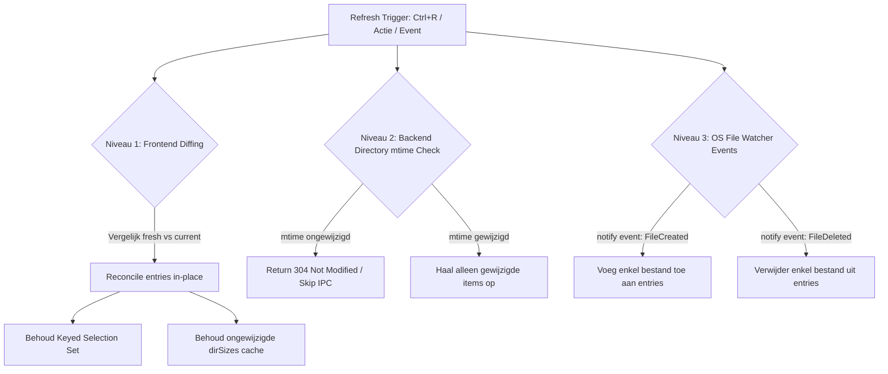

# Incrementele File List Refresh Architectuur- en Uitvoeringsplan

**Datum:** 2026-07-30  
**Status:** Voorgesteld verbeterplan  
**Doelbestand:** `packages/ui/src/lib/components/FileList.svelte` & Rust VFS (`apps/desktop/src-tauri/src/vfs.rs`)  
**Context:** Optimalisatie van de interne bestandsoverzichtherlaadactie (refresh) om visual flicker, herberekeningen, verlies van mapgroottes en selectieverschuivingen te elimineren.

---

## 1. Context & Probleemstelling

In de huidige versie van NexusCommander veroorzaakt het aanroepen van `refresh()` of `loadDirectory(currentPath)` in [`FileList.svelte`](file:///home/djawiz/Data/Development/_Apps/NexusCommander/packages/ui/src/lib/components/FileList.svelte) een **volledige herlaadbeurt van de bestandslijst**. 

Dit brengt de volgende knelpunten met zich mee:

1. **Volledige array-vervanging (`entries = result`)**:
   De complete lijst met Javascript-objecten voor alle bestanden wordt bij elke refresh opnieuw opgebouwd. Dit forceert Svelte om alle zichtbare rijen in de virtuele scroller te herbalanceren.
2. **Selectieverschuiving door index-gebaseerde opslag (`Set<number>`)**:
   `selectedEntries` is momenteel gedefinieerd als een `Set<number>` met rij-indices. Als er bestanden boven de huidige selectie worden toegevoegd of verwijderd tijdens een refresh, verschuiven de indexen en wijzen geselecteerde rijen naar verkeerde bestanden.
3. **Wissen van de Mapgrootte Cache (`dirSizes`)**:
   Bij elke refresh worden alle berekende of in-berekening zijnde mapgroottes (`dirSizes`, `calculatedDirs`, `calculatingDirs`) onvoorwaardelijk gewist en geaborteerd via `abortDirSizeCalcs()`.
4. **Visuele flikkering en UI-stutter**:
   Door tijdens `loadDirectory()` de vlag `loading = true` te zetten of de lijst leeg te maken, ontstaat er visuele stuttering en verlies van focus- of scrollstabiliteit.
5. **Overbodige IPC Overhead**:
   Bij mappen met duizenden bestanden wordt de gehele lijst opnieuw verzonden over de IPC-bridge, zelfs als er slechts 1 bestand is toegevoegd of de map ongewijzigd is.

---

## 2. Drie-traps Oplossingsarchitectuur

Om de refresh incrementeel en differentieel te maken, onderkennen we drie integratieniveaus:



---

### Niveau 1: Frontend Differential Reconciliation (Direct in Svelte)

* **Keyed Selection (`Set<string>`)**:
  Herdefinieer `selectedEntries` als `Set<string>` (waarin de unieke bestandsnaam of het volledige pad wordt opgeslagen i.p.v. de rij-index). Selecties blijven hierdoor 100% stabiel, ongeacht het toevoegen of verwijderen van bestanden boven of onder de selectie.
* **Slimme In-place Array Reconciliation (`reconcileEntries`)**:
  Bij een refresh (`isRefresh = true`) wordt het nieuwe resultaat vergeleken met de huidige `entries` op basis van `entry.name`:
  - **Ongewijzigd**: Bestaande Javascript-objectreferenties blijven behouden.
  - **Eigenschappen gewijzigd** (`size`, `modified`, `permissions`): Alleen de betreffende eigenschappen op het bestaande object bijwerken via `Object.assign`.
  - **Verwijderd**: Enkel de verwijderde items uit de array splicen.
  - **Toegevoegd**: Enkel de nieuwe `FileEntry` objecten invoegen.
* **Gecontextualiseerd Behoud van `dirSizes`**:
  Mapgroottes in de cache worden uitsluitend ongeldig gemaakt als de `modified` timestamp van de specifieke map is gewijzigd.
* **Naadloze Stille Refresh**:
  Bij een interne refresh blijft `loading = false` om UI-flikkeringen en herberekeningen van de scroller te voorkomen.

---

### Niveau 2: Backend Directory `mtime` & Delta IPC API

* **Directory `mtime` Fast-Path Check**:
  Vóór het inlezen van een volledige map vraagt de frontend of de aanpassingsdatum (`mtime`) van de map zelf is gewijzigd t.o.v. de vorige lezing. Indien ongewijzigd, retourneert de backend direct een snelle afhandeling.
* **Delta IPC Endpoint (`readDirectoryDelta`)**:
  De frontend stuurt een snapshot van bekende bestandnamen met hun `mtime`. De backend vergelijkt dit in de VFS en stuurt uitsluitend een delta-payload terug:
  ```json
  {
    "added": [ { "name": "nieuw.txt", "size": 1024, ... } ],
    "removed": [ "oud.txt" ],
    "updated": [ { "name": "gewijzigd.txt", "size": 2048, ... } ]
  }
  ```

---

### Niveau 3: Event-Driven Real-Time File System Watcher

* **OS File Watcher (`notify` crate in Rust)**:
  De desktop-backend registreert een watcher op de paden van het linker- en rechterpaneel.
* **Event-Driven IPC Dispatching**:
  Zodra een bestand extern wordt aangemaakt, verwijderd of hernoemd, vuurt Tauri een IPC-event `nc:file-changed` af naar het betreffende paneel. Het paneel werkt direct enkel dat specifieke bestand bij in `entries`, zonder dat een handmatige refresh of polling nodig is.

---

## 3. Uitvoeringsfaseringen & Aanbevelingen

| Fase | Omschrijving | Scope | Risico / Complexiteit |
|---|---|---|---|
| **Fase 1** *(Aanbevolen eerste stap)* | **Frontend Reconciliatie & Keyed Selection**<br>- Omzetten `selectedEntries` van `Set<number>` naar `Set<string>`.<br>- Implementeren `reconcileEntries()` in `FileList.svelte`.<br>- Behoud `dirSizes` cache voor ongewijzigde mappen.<br>- Stille refresh inschakelen voor `isRefresh`. | `packages/ui/src/lib/components/FileList.svelte` | Laag / Hoge visuele impact |
| **Fase 2** | **Backend `mtime` & Delta IPC**<br>- Toevoegen `mtime` check en delta-contract in IPC. | `packages/ui/src/lib/ipc-contract.ts`, `apps/desktop/src-tauri/src/vfs.rs` | Gemiddeld |
| **Fase 3** | **Real-time OS File Watcher**<br>- Integratie van de Rust `notify` crate voor actieve paneelpaden. | `apps/desktop/src-tauri/src/lib.rs` | Gemiddeld/Hoog |

---

## 4. Specificatie Fase 1 Implementatie (`FileList.svelte`)

### 4.1 Keyed Selection

```ts
// OUDE SITUATIE:
// let selectedEntries = $state(new Set<number>());

// NIEUWE SITUATIE:
let selectedEntries = $state(new Set<string>()); // Bestandsnamen of unieke sleutels
```

### 4.2 Reconciliatie Functie

```ts
/**
 * Voert een incrementele update uit op de bestaande entries array.
 * Behoudt objectreferenties voor ongewijzigde bestanden.
 */
function reconcileEntries(currentEntries: FileEntry[], freshEntries: FileEntry[]): FileEntry[] {
  const freshMap = new Map(freshEntries.map((e) => [e.name, e]));
  const updatedList: FileEntry[] = [];

  // 1. Bijwerken en behouden van bestaande objecten
  for (const existing of currentEntries) {
    const fresh = freshMap.get(existing.name);
    if (fresh) {
      // Werk eigenschappen bij indien gewijzigd
      if (
        existing.size !== fresh.size ||
        existing.modified !== fresh.modified ||
        existing.permissions !== fresh.permissions
      ) {
        existing.size = fresh.size;
        existing.modified = fresh.modified;
        existing.permissions = fresh.permissions;
      }
      updatedList.push(existing);
      freshMap.delete(existing.name);
    }
  }

  // 2. Toevoegen van nieuwe bestanden
  for (const newEntry of freshMap.values()) {
    updatedList.push(newEntry);
  }

  return updatedList;
}
```

---

## 5. Validatie en Acceptatiecriteria

1. **Geen Scroll jumps / Flikkeringen**: Bij het drukken op `Ctrl+R` of een interne herlaadactie verspringt het scrollvenster niet en treedt er geen flikkering op.
2. **Behoud van Selectie**: Geselecteerde bestanden blijven geselecteerd, ook als er bestanden boven of onder de selectie worden toegevoegd/verwijderd.
3. **Behoud van Berekende Mapgroottes**: Mapgroottes die reeds berekend zijn (`dirSizes`) blijven zichtbaar na een refresh als de map-mtime niet gewijzigd is.
4. **Performantie**: Enkel de gewijzigde DOM-rijen worden door Svelte opnieuw gerenderd in de virtuele lijst (`{#each visibleEntries as entry (entry.name)}`).
